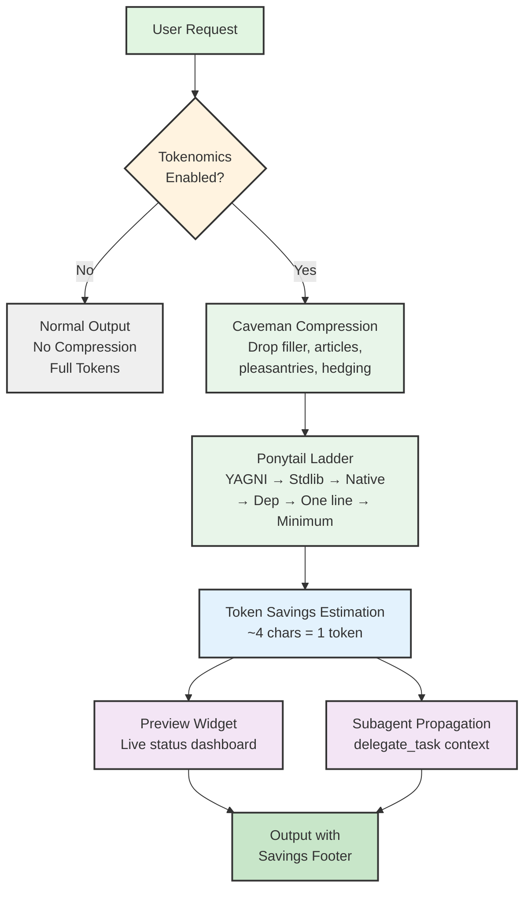
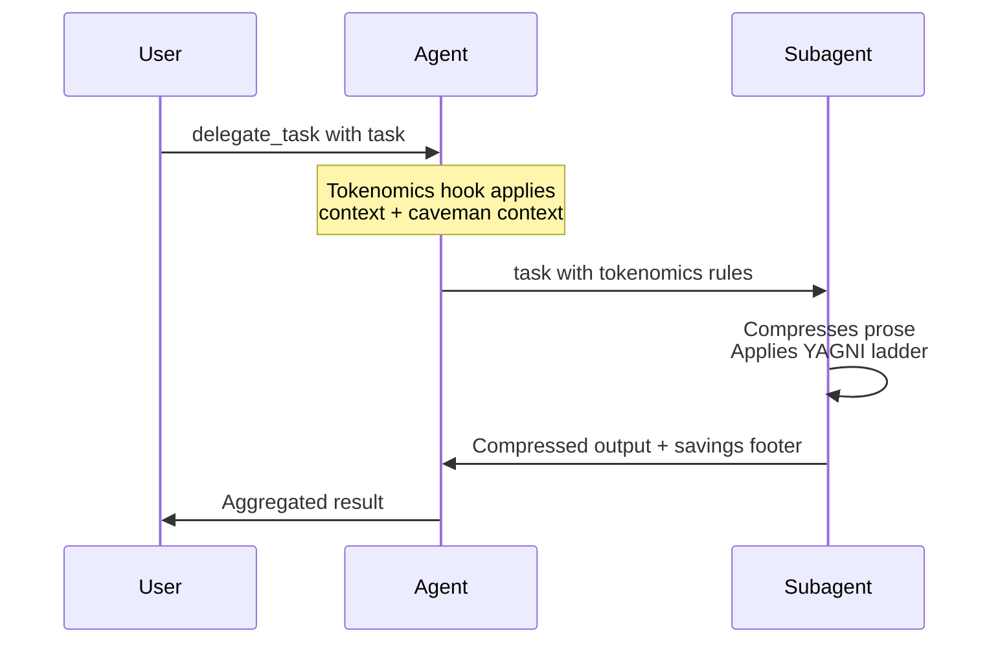

                                   ███╗   ███╗ █████╗ ██╗   ██╗████████╗
                                   ████╗ ████║██╔══██╗██║   ██║╚══██╔══╝
                                   ██╔████╔██║███████║██║   ██║   ██║
                                   ██║╚██╔╝██║██╔══██║██║   ██║   ██║
                                   ██║ ╚═╝ ██║██║  ██║╚██████╔╝   ██║
                                   ╚═╝     ╚═╝╚═╝  ╚═╝ ╚═════╝    ╚═╝
                                   ███████╗███████╗ █████╗ ██████╗ ███████╗
                                   ██╔════╝██╔════╝██╔══██╗██╔══██╗██╔════╝
                                   ███████╗█████╗  ███████║███████║███████╗
                                   ╚════██║██╔══╝  ╚════██║██╔════╝╚════██║
                                   ███████║███████╗ ███████║██║     ███████║
                                   ╚══════╝╚══════╝ ╚══════╝╚═╝     ╚══════╝

                              Tokenomics v1.0.0
                         Caveman + Ponytail = Maximum Efficiency
                         Compress prose. Minimize code. Save tokens.

[](https://opensource.org/licenses/MIT)
[](https://python.org)
[](https://claude.ai/code)
[](https://cursor.sh)
[](https://antigravity.sh)
[](https://openai.com/codex)
[](https://hermes-agent.nousresearch.com)

---

# Tokenomics

**Cross-platform agent efficiency toolkit.** Merge [caveman](https://github.com/JuliusBrussee/caveman) (prose compression) + [ponytail](https://github.com/DietrichGebert/ponytail) (code minimization) into one skill/plugin that works with Claude Code, Cursor, Antigravity, Codex, Hermes, and every SKILL.md-compatible agent.

---

## What It Does

Tokenomics attacks token waste from two directions:

| Layer | What it compresses | Typical savings |
|-------|-------------------|-----------------|
| **Caveman** | Agent's **prose output** — drops articles, filler, pleasantries, hedging | ~65% fewer output words |
| **Ponytail** | Agent's **code output** — YAGNI decision ladder before any code | ~54% less code (LOC) |

They don't overlap. Caveman leaves code byte-for-byte exact. Ponytail stays out of the prose. Use them together for compound savings.

---

## Mermaid Architecture



---

## Ponytail Decision Ladder

Before writing any code, the agent climbs this ladder and stops at the first rung that holds:

```mermaid
graph LR
    1[1. Does this need to exist?<br/>YAGNI — skip it] --> 2[2. Already in codebase?<br/>Reuse it]
    2 --> 3[3. Stdlib does it?<br/>Use it]
    3 --> 4[4. Native platform feature?<br/>Use it]
    4 --> 5[5. Installed dependency?<br/>Use it]
    5 --> 6[6. Can it be one line?<br/>Write one line]
    6 --> 7[7. Minimum code that works]
    style 1 fill:#ffcccc,stroke:#333,stroke-width:2px
    style 2 fill:#ffcccc,stroke:#333,stroke-width:2px
    style 3 fill:#ffcccc,stroke:#333,stroke-width:2px
    style 4 fill:#ffcccc,stroke:#333,stroke-width:2px
    style 5 fill:#ffcccc,stroke:#333,stroke-width:2px
    style 6 fill:#ffcccc,stroke:#333,stroke-width:2px
    style 7 fill:#ccffcc,stroke:#333,stroke-width:2px
```



---

## Subagent Propagation

When `delegate_task` spawns a subagent, tokenomics context is automatically applied:



---

## Triggers

Say any of these in chat:

| Trigger | Effect |
|---------|--------|
| `tokenomics enable` | Activate compression + savings display |
| `tokenomics disable` | Deactivate — no compression, no footer |
| `tokenomics status` | View cumulative savings |
| `tokenomics estimate <text>` | Preview savings for specific text |
| `tokenomics review <code>` | Ponytail over-engineering review |
| `tokenomics audit` | Full savings summary + recommendations |
| `caveman mode` | Activate prose compression |
| `ponytail mode` | Activate code minimization |
| `less tokens` / `minimal code` | Activate both |
| `stop caveman` / `normal mode` | Deactivate |

---

## Installation

### Option 1: pip (recommended)

```bash
pip install tokenomics
tokenomics enable
```

### Option 2: From source

```bash
git clone https://github.com/z99wE/tokenomics.git
cd tokenomics
pip install -e .
tokenomics enable
```

### Option 3: Manual skill copy

Copy `SKILL.md` to your agent's skills directory:

| Platform | Path |
|----------|------|
| Claude Code | `~/.claude/skills/tokenomics/SKILL.md` |
| Cursor | `~/.cursor/skills/tokenomics/SKILL.md` |
| Antigravity | `~/.antigravity/skills/tokenomics/SKILL.md` |
| Codex | `~/.agents/skills/tokenomics/SKILL.md` |
| OpenAI Codex | `~/.codex/skills/tokenomics/SKILL.md` |
| Hermes | `~/.hermes/skills/tokenomics/SKILL.md` + plugin install |

All platforms use the same open **SKILL.md** standard (agentskills.io).

---

## Usage Examples

### Enable tokenomics at session start

```bash
tokenomics enable
```

### Estimate savings for a block of text

```bash
tokenomics estimate "Sure! I can help you implement this feature. Basically you just need to create a function..."
# Output:
# Original:   24 tokens
# Compressed: 18 tokens
# Saved:      6 tokens (25% reduction)
```

### Ponytail code review

```bash
tokenomics review --code "class UserFactoryManagerServiceController: ..."
# Output:
# Issues found:
#   • Possible unnecessary abstraction layer — consider simpler functions
#   • Deep nesting (6 levels) — consider extracting functions
#   Token savings: 156 → 106 (saved 50 tokens)
```

### Full audit

```bash
tokenomics audit
# Shows: enabled state, turns, chars compressed, tokens saved, compression ratio
```

### Preview widget

Open `~/.hermes/plugins/tokenomics/preview.html` in any browser for a live status dashboard with auto-refresh.

---

## CLI Reference

```
tokenomics <command> [options]

Commands:
  enable     Activate compression + savings display
  disable    Deactivate — no compression, no footer
  status     Show cumulative savings and compression ratio
  estimate   Preview token savings for specific text
  review     Ponytail-style over-engineering review of code
  audit      Full audit: savings, ratio, recommendations
  ladder     Show ponytail YAGNI decision ladder
  logo       Show ASCII logo
```

---

## Platform Compatibility

| Platform | Skill Path | Hermes Plugin |
|----------|-----------|---------------|
| Claude Code | `~/.claude/skills/` | N/A (skill only) |
| Cursor | `~/.cursor/skills/` | N/A (skill only) |
| Antigravity | `~/.antigravity/skills/` | N/A (skill only) |
| Codex | `~/.agents/skills/` | N/A (skill only) |
| OpenAI Codex | `~/.codex/skills/` | N/A (skill only) |
| Hermes | `~/.hermes/skills/` | `~/.hermes/plugins/tokenomics/` |

All platforms use the same open **SKILL.md** standard. The Hermes plugin adds tool-level enforcement (`tokenomics.enable`, `tokenomics.disable`, etc.) and hook-based behavior (`pre_llm_call`, `pre_tool_call`, `post_tool_call`, `delegate_task`).

---

## License

MIT License. See [LICENSE](LICENSE) for details.

---

## Links

- [GitHub Repository](https://github.com/z99wE/tokenomics)
- [Caveman (JuliusBrussee)](https://github.com/JuliusBrussee/caveman)
- [Ponytail (DietrichGebert)](https://github.com/DietrichGebert/ponytail)
- [Agent Skills Standard](https://agentskills.io)
