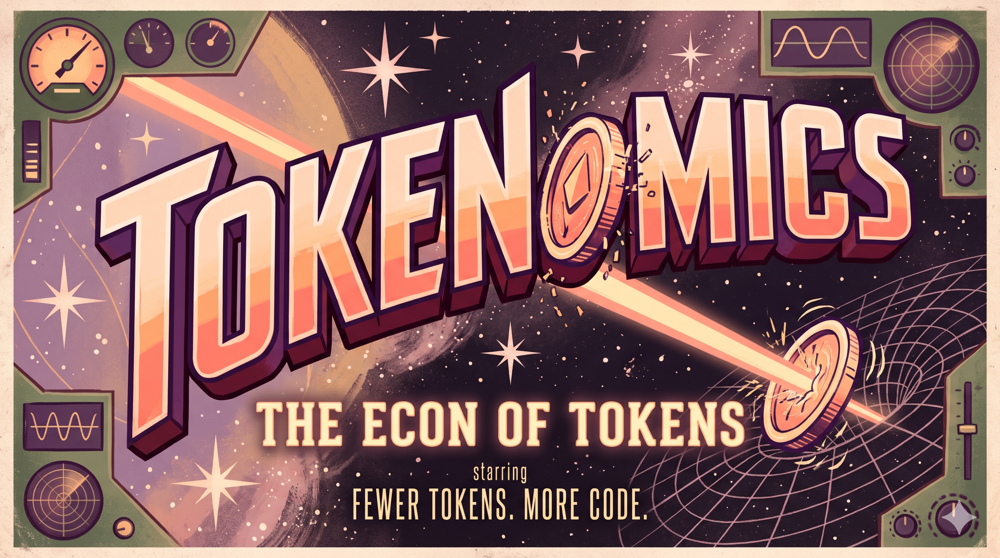
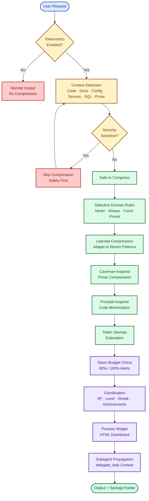
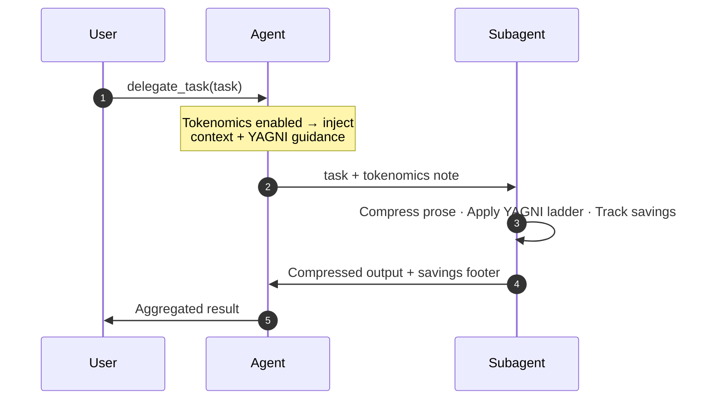

<p align="center">
  
</p>

<h1 align="center">Tokenomics</h1>

<p align="center">
  <strong>Small mouth, big brain. Minimum code, maximum impact.</strong><br>
  <em>Agentic efficiency layer for AI agents — compresses prose, minimizes code, tracks savings.</em>
</p>

<p align="center">
  <a href="https://opensource.org/licenses/MIT"></a>
  <a href="https://python.org"></a>
  <a href="https://github.com/z99wE/tokenomics-plugin"></a>
  <a href="https://claude.ai/code"></a>
  <a href="https://cursor.sh"></a>
  <a href="https://antigravity.sh"></a>
  <a href="https://openai.com/codex"></a>
  <a href="https://hermes-agent.nousresearch.com"></a>
</p>

---

# Tokenomics

**Tokenomics is an agentic efficiency layer** that sits between your AI agent and its output. It compresses agent prose, minimizes code generation, tracks token savings, and learns from your behavior — all while keeping safety and authorization at the forefront.

Tokenomics is **inspired by** the concepts behind [caveman](https://github.com/JuliusBrussee/caveman) (prose compression) and [ponytail](https://github.com/DietrichGebert/ponytail) (code minimization), but it is **engineered independently** as its own system with context awareness, learned compression, gamification, subagent propagation, token budgeting, and cross-agent memory.

---

## What Makes Tokenomics Different

| Capability | Caveman | Ponytail | Tokenomics v2.3 |
|------------|---------|----------|-----------------|
| Compresses prose | ✅ | ❌ | ✅ |
| Minimizes code | ❌ | ✅ | ✅ |
| Context-aware (code vs docs vs secrets) | ❌ | ❌ | **✅** |
| Learned compression (adapts to your reverts) | ❌ | ❌ | **✅** |
| Selective domain rules | ❌ | ❌ | **✅** |
| Token budget with 80%/100% alerts | ❌ | ❌ | **✅** |
| Project-type smart defaults | ❌ | ❌ | **✅** |
| Gamification (levels, XP, streaks) | ❌ | ❌ | **✅** |
| Subagent propagation | ❌ | ❌ | **✅** |
| Preview widget | ❌ | ❌ | **✅** |
| No injection hook | N/A | N/A | **✅** |
| 135 test cases | ❌ | ❌ | **✅** |

Tokenomics is not a wrapper around either tool. It is a **separate engineering project** that draws inspiration from their concepts and builds its own architecture on top.

---

## Architecture



---

## Ponytail-Inspired Decision Ladder

Before writing any code, climb this ladder and **stop at the first rung that holds**:

```mermaid
flowchart LR
    R1["1 · Does it need to exist?<br/>(YAGNI — skip it)"] --> R2["2 · Already in codebase?<br/>(reuse it)"]
    R2 --> R3["3 · Stdlib does it?<br/>(use it)"]
    R3 --> R4["4 · Native platform feature?<br/>(use it)"]
    R4 --> R5["5 · Installed dependency?<br/>(use it)"]
    R5 --> R6["6 · Can it be one line?<br/>(write one line)"]
    R6 --> R7["7 · Minimum code<br/>that works"]

    classDef ask fill:#fee2e2,stroke:#991b1b,stroke-width:2px,color:#7f1d1d
    classDef reuse fill:#fef3c7,stroke:#92400e,stroke-width:2px,color:#78350f
    classDef stdlib fill:#dcfce7,stroke:#166534,stroke-width:2px,color:#14532d
    classDef native fill:#dbeafe,stroke:#1e40af,stroke-width:2px,color:#1e3a8a
    classDef dep fill:#ede9fe,stroke:#5b21b6,stroke-width:2px,color:#4c1d95
    classDef oneline fill:#fae8ff,stroke:#86198f,stroke-width:2px,color:#701a75
    classDef write fill:#d1fae5,stroke:#065f46,stroke-width:2px,color:#064e3b

    class R1 ask
    class R2 reuse
    class R3 stdlib
    class R4 native
    class R5 dep
    class R6 oneline
    class R7 write
```



---

## Subagent Propagation

When you delegate work to a subagent, Tokenomics context (compression rules, learned patterns, safety gates) travels with it.



---

## Context-Aware Compression

Tokenomics doesn't blindly compress everything. It first **detects what kind of content** it's looking at:

| Content Type | Strategy | Example |
|-------------|----------|---------|
| **Code** | Minimal — preserve structure, imports, comments | Only remove truly redundant patterns |
| **Docs** | Moderate — keep structure, cut filler | Remove "basically", "actually", etc. |
| **Commits** | Aggressive — conventional commit style | "Fix bug" not "Fix the bug in the login function" |
| **Secrets / Auth** | **Never compress** | API keys, passwords, tokens left untouched |
| **SQL** | Light — preserve query structure | Remove whitespace, keep semantics |
| **Prose** | Standard — drop articles, filler, hedging | Remove "just", "really", "basically" |

Security-sensitive content (API keys, passwords, crypto keys) is **never** compressed or modified.

---

## Core Features

### Caveman-Inspired Prose Compression
Drops articles (a/an/the), filler words (just/really/basically), pleasantries (sure/certainly), and hedging (maybe/I think). Keeps code blocks, technical terms, API names, and error strings exact.

### Ponytail-Inspired Code Minimization
Before writing code, climbs the YAGNI ladder:
1. Does this need to exist? → Skip it
2. Already in codebase? → Reuse it
3. Stdlib does it? → Use it
4. Native platform feature? → Use it
5. Installed dependency? → Use it
6. Can it be one line? → Write one line
7. Only then: minimum code that works

### Token Savings Estimation
Real token counting via tiktoken (cl100k_base) with character-count fallback. Every compressed output shows estimated tokens saved.

### Token Budget with Alerts
Set a daily token budget and get notified at 80% and 100% usage:
```bash
tokenomics budget set 5000      # Set daily limit
tokenomics budget record 4200   # Record tokens used
# ⚠️ Token budget alert: 4200/5000 used (84%)
```

### Gamification
Levels, XP, streaks, and achievements (First Savings, Token Hoarder, Token Miser, Lazy Senior Dev, YAGNI Master, Three-Day Streak, Week Warrior) give you feedback on your token efficiency.

### Selective Domain Compression
Never compress security/auth/crypto content. Always compress docs/changelog. Force specific presets per domain. Learned compression adapts based on what you revert vs accept.

### Auto-Learn
Tokenomics tracks which compression patterns you revert vs accept, and automatically adapts future compression decisions.

### Project-Type Smart Defaults
Set your project type (web/cli/library/api) for smart default domain rules.

---

## Subagent Propagation

When you delegate a task to a subagent, Tokenomics context is automatically applied — the compression rules, learned patterns, and safety guidelines all carry over.

---

## Hermes Plugin: 11 Tools, 5 Hooks

**Tools:**
| Tool | What it does |
|------|-----------|
| `tokenomics.enable` | Activate compression + savings display |
| `tokenomics.disable` | Deactivate — no compression, no footer |
| `tokenomics.status` | Cumulative savings, level, streak, achievements |
| `tokenomics.estimate` | Preview savings for specific text |
| `tokenomics.review` | Ponytail-inspired over-engineering review |
| `tokenomics.audit` | Full audit with recommendations |
| `tokenomics.domain` | Manage selective compression rules |
| `tokenomics.achievements` | Check newly unlocked achievements |
| `tokenomics.budget` | Daily token budget + 80%/100% alerts |
| `tokenomics.project` | Project type for smart defaults |
| `tokenomics.learn` | Auto-learn from user revert patterns |

**Hooks:**
| Hook | What it does |
|------|-----------|
| `pre_tool_call` | Compresses string arguments before tool execution |
| `post_tool_call` | Compresses tool result output + tracks savings |
| `on_session_start` | Writes preview widget |
| `on_session_end` | Final state save + preview refresh |
| `delegate_task` | Propagates tokenomics context to subagents |

> **No injection hook.** The `pre_llm_call` hook was removed in v2.1.0. Tokenomics never prepends hidden instructions to your LLM prompts.

---

## CLI Reference

```
tokenomics <command> [options]

Commands:
  enable      Activate compression + savings display
  disable     Deactivate — no compression, no footer
  status      Show cumulative savings and compression ratio
  estimate    Preview token savings for specific text
  review      Ponytail-style over-engineering review of code
  audit       Full audit: savings, ratio, recommendations
  ladder      Show ponytail YAGNI decision ladder
  logo        Show ASCII logo
  domain      Manage selective compression rules
  achievements Check for newly unlocked achievements
  budget      Daily token budget + alerts
  record      Record tokens consumed and check budget
  project     Set project type for smart defaults
  learn       Toggle auto-learn from user reverts
  defaults    Toggle smart default suggestions
```

**Examples:**
```bash
tokenomics enable
tokenomics estimate "This is a really simple test."
tokenomics review --code "class UserFactoryManagerServiceController: ..."
tokenomics budget set 5000
tokenomics budget record 4200
tokenomics project web
tokenomics learn true
tokenomics disable
```

---

## Installation

### Option 1: pip (recommended)
```bash
pip install tokenomics
tokenomics enable
```

### Option 2: With real tokenizer
```bash
pip install "tokenomics[tiktoken]"
tokenomics enable
```

### Option 3: From source
```bash
git clone https://github.com/z99wE/tokenomics-plugin.git
cd tokenomics
pip install -e .
tokenomics enable
```

### Option 4: Manual skill copy
Copy `SKILL.md` to your agent's skills directory:

| Platform | Path |
|----------|------|
| Claude Code | `~/.claude/skills/tokenomics/SKILL.md` |
| Cursor | `~/.cursor/skills/tokenomics/SKILL.md` |
| Antigravity | `~/.antigravity/skills/tokenomics/SKILL.md` |
| Codex | `~/.agents/skills/tokenomics/SKILL.md` |
| OpenAI Codex | `~/.codex/skills/tokenomics/SKILL.md` |
| Hermes | `~/.hermes/skills/tokenomics/SKILL.md` + plugin install |

All platforms use the same open **SKILL.md** standard (agentskills.io).

---

## Testing

Tokenomics has **135 test cases** covering core compression, state management, Hermes plugin handlers/hooks, and CLI commands:

```bash
python -m unittest tokenomics.tests.test_core tokenomics.tests.test_hermes tokenomics.tests.test_cli -v
```

All 135 tests pass. The project uses **ruff** for linting:

```bash
ruff check .
```

---

## License

MIT License. See [LICENSE](LICENSE) for details.

---

## Inspiration & Attribution

Tokenomics is **inspired by** the concepts behind:
- **[caveman](https://github.com/JuliusBrussee/caveman)** — prose compression
- **[ponytail](https://github.com/DietrichGebert/ponytail)** — code minimization

Tokenomics is **engineered independently** as its own project. It reimplements these concepts with its own architecture, context detection, learned compression, gamification, token budgeting, and agentic features. All code in this repository is original work by the Tokenomics contributors.

---

## Links

- [GitHub Repository](https://github.com/z99wE/tokenomics-plugin)
- [caveman](https://github.com/JuliusBrussee/caveman) — inspiration for prose compression
- [ponytail](https://github.com/DietrichGebert/ponytail) — inspiration for code minimization
- [Agent Skills Standard](https://agentskills.io)
- [dsh-plugin.org](https://dsh-plugin.org) — DeepSeek Harness Plugin hub

---

## DSH Plugin Submission (DeepSeek Harness)

Tokenomics is also published as a **DSH Plugin** for the DeepSeek Harness ecosystem.

### One-Line Value

After installing, your AI agent's prose is compressed, code is minimized via the YAGNI ladder, and token savings are tracked and gamified — with zero hidden prompt injection and no secrets ever touched.

### Submission Details

| Field | Value |
|-------|-------|
| **Repository** | https://github.com/z99wE/tokenomics-plugin |
| **Author** | Souvik Chakraborty |
| **License** | MIT |
| **Category** | Tools & Capabilities |
| **Profile** | web |
| **Entry Point** | `apply.js` (exports `apply(ctx)`) |
| **Package** | `tokenomics-dsh-plugin` |

### Trust Signals

| Signal | Details |
|--------|---------|
| **License** | MIT — free to reuse, modify, and build on |
| **Permissions** | None beyond local filesystem state (`~/.hermes/...`, `~/.tokenomics/...`). No network calls, no telemetry |
| **External services** | None — all processing is local |
| **Compatibility** | DeepSeek Harness `web` profile · Python ≥ 3.9 · Node ≥ 18 · Hermes ≥ 0.22 |
| **Safety** | Never compresses secrets, auth, crypto, SQL, or security-critical code |
| **Screenshots / demo** | Preview widget: `~/.hermes/plugins/tokenomics/preview.html` (HTML dashboard with XP, streaks, achievements). See `assets/logo.png` for branding |
| **Tests** | 135 passing (core, Hermes plugin, CLI) · `ruff check .` clean |

### Install Command

```bash
# From NPM (when published):
dsh plugin --profile web add tokenomics-dsh-plugin

# From source (works now):
dsh plugin --profile web add github:z99wE/tokenomics-plugin
```

### Pre-submission Checklist

- [x] Repository is public
- [x] GitHub topic `dsh-plugin` added
- [x] README includes install command
- [x] Plugin exports `apply(ctx)` module (`apply.js`)
- [x] Repository root includes `package.json`
- [x] Open-source license declared (MIT)
- [ ] Publish to NPM (optional — for Plugin Hub listing)
- [ ] Add `dsh-plugin` topic on GitHub

### DSH Plugin FAQ

**Does submitting cost money?**
No. Submitting a DSH Plugin is completely free.

**How long does review take?**
Depends on whether the repository meets the requirements. Publish a public repo, add the `dsh-plugin` topic, write a solid README, and the plugin is usually listed within one refresh cycle.

**Why hasn't my plugin been listed?**
Common reasons: repo not public, `dsh-plugin` topic missing, no `package.json` at root, no install command in README, or no `apply(ctx)` export.

**Is my plugin marked "unconfirmed"?**
Newly listed plugins start as `unconfirmed` and become verified after manual review. Polish your README with install and usage notes to speed it up.

**Can I submit a non-open-source plugin?**
No. The hub only lists plugins from public repositories with source access.
