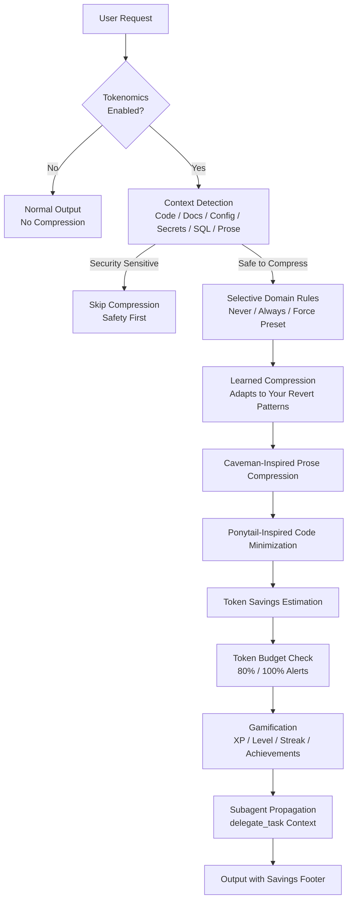

# Tokenomics for Claude Code

**Small mouth, big brain. Minimum code, maximum impact.**

Tokenomics is inspired by the concepts behind caveman (prose compression)
and ponytail (code minimization), engineered independently as its own
system for Claude Code.

## What It Does

| Layer | What it compresses | Typical savings |
|-------|-------------------|-----------------|
| Caveman-inspired | Agent's **prose output** — drops articles, filler, pleasantries, hedging | ~65% fewer output tokens |
| Ponytail-inspired | Agent's **code output** — YAGNI decision ladder before any code | ~54% less code |

They don't overlap. Caveman-inspired leaves code byte-for-byte exact. Ponytail-inspired stays out of the prose. Use them together for compound savings.

## Mermaid Architecture



## Ponytail-Inspired Decision Ladder

Before writing any code, climb this ladder and stop at the first rung that holds:

1. Does this need to exist? (YAGNI — skip it)
2. Already in this codebase? (reuse it)
3. Stdlib does it? (use it)
4. Native platform feature? (use it)
5. Installed dependency solves it? (use it)
6. Can it be one line? (write one line)
7. Only then: minimum code that works

Never cut validation, error handling, security, or accessibility.

## Triggers

Say any of these in Claude Code:

| Trigger | Effect |
|---------|--------|
| `tokenomics enable` | Activate compression + savings display |
| `tokenomics disable` | Deactivate — no compression, no footer |
| `tokenomics status` | View cumulative savings, level, streak |
| `tokenomics estimate <text>` | Preview savings for specific text |
| `tokenomics review <code>` | Ponytail-inspired over-engineering review |
| `tokenomics audit` | Full savings summary + recommendations |
| `tokenomics budget set <N>` | Set daily token budget |
| `tokenomics budget check` | Check current budget usage |
| `tokenomics project web\|cli\|library\|api` | Set project type for smart defaults |
| `tokenomics learn true\|false` | Toggle auto-learn from user reverts |

## Installation

Copy this `SKILL.md` to `~/.claude/skills/tokenomics/`.

Or install via pip:

```bash
pip install tokenomics
tokenomics enable
```

## License

MIT License.

## Inspiration

Tokenomics is **inspired by** caveman (prose compression) and ponytail (code minimization), but engineered independently as its own project.

- GitHub: https://github.com/z99wE/tokenomics
- caveman: https://github.com/JuliusBrussee/caveman
- ponytail: https://github.com/DietrichGebert/ponytail
