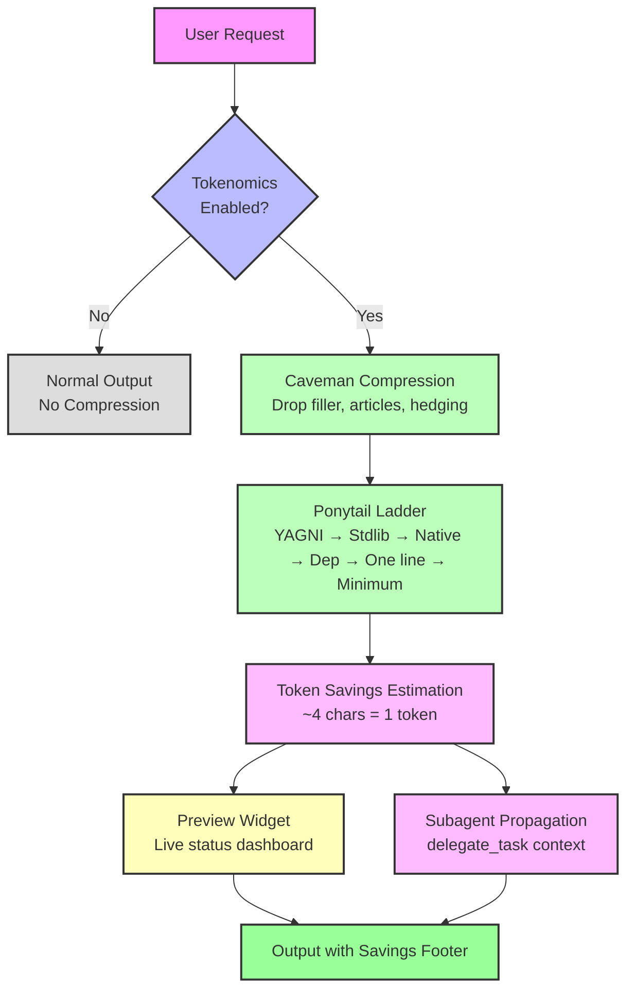
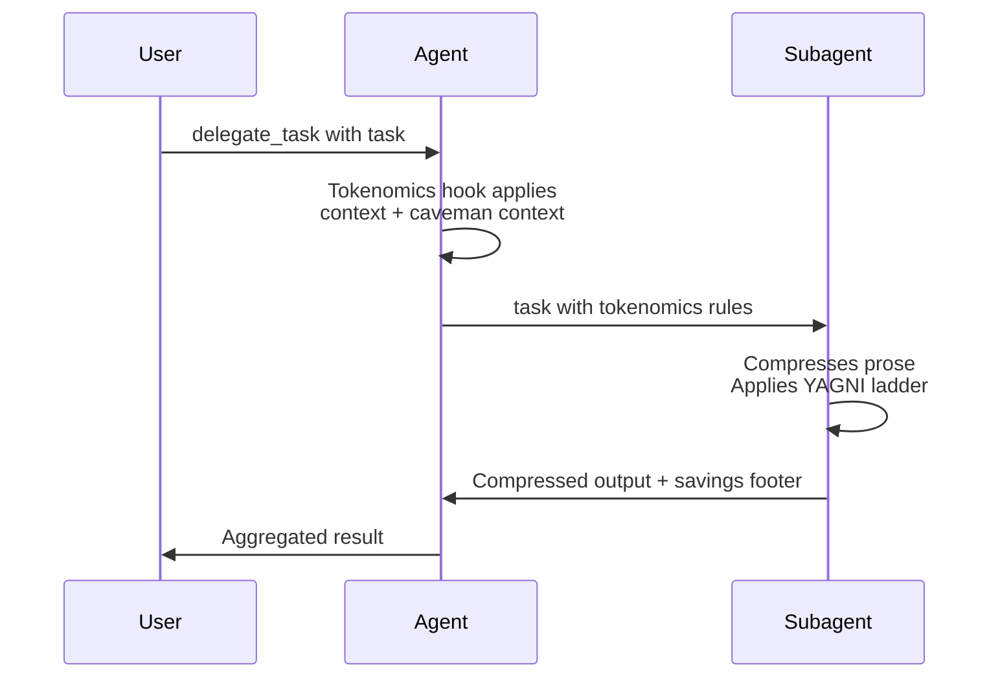

# Tokenomics Skill

**Small mouth, big brain. Minimum code, maximum impact.**

Tokenomics is inspired by the concepts behind caveman (prose compression)
and ponytail (code minimization), engineered independently as its own system.

- **Caveman-inspired** compresses what the agent *says*: drops articles, filler, pleasantries, hedging. Keeps code blocks, technical terms, errors exact. ~65% fewer output tokens.
- **Ponytail-inspired** compresses what the agent *builds*: decision ladder before any code — need it? → reuse? → stdlib? → native? → dep? → one line? → minimum. ~54% less code.
- **Tokenomics** displays estimated token savings on every output when active.

---

## Mermaid Architecture



---

## When to Use

Load this skill when you want:

- Shorter, terser agent responses with full technical accuracy preserved
- Minimal code generation — no over-engineering, no unnecessary dependencies
- Visible token savings tracked per turn and cumulatively
- Tokenomics rules propagated to subagents via `delegate_task`

## Triggers

Say any of these:
- `tokenomics on` / `tokenomics enable` / `tokenomics off` / `tokenomics disable`
- `caveman mode` / `ponytail mode` / `caveman ponytail`
- `less tokens` / `minimal code` / `lazy senior dev`
- `/tokenomics status` (view cumulative savings)
- `/tokenomics review <code>` (ponytail-style over-engineering review)
- `/tokenomics audit` (full savings summary + recommendations)

---

## Behavior When Active

### Caveman (prose compression)

**Drop:** articles (a/an/the), filler (just/really/basically/actually/simply), pleasantries (sure/certainly/of course/happy to), hedging (maybe/possibly/I think).

**Keep:** code blocks byte-for-byte, technical terms exact, API names exact, error strings exact, file paths exact.

**Use:** short synonyms (fix not "implement a solution for"), abbreviations (DB/auth/config/req/res/fn/impl), arrows for causality (X -> Y).

### Ponytail (code minimization)

Before writing code, climb the ladder and stop at the first rung that holds:

```mermaid
graph LR
    1[1. Does this need to exist?<br/>YAGNI — skip it] --> 2[2. Already in codebase?<br/>Reuse it]
    2 --> 3[3. Stdlib does it?<br/>Use it]
    3 --> 4[4. Native platform feature?<br/>Use it]
    4 --> 5[5. Installed dependency?<br/>Use it]
    5 --> 6[6. Can it be one line?<br/>Write one line]
    6 --> 7[7. Minimum code that works]
    style 1 fill:#f96,stroke:#333
    style 2 fill:#f96,stroke:#333
    style 3 fill:#f96,stroke:#333
    style 4 fill:#f96,stroke:#333
    style 5 fill:#f96,stroke:#333
    style 6 fill:#f96,stroke:#333
    style 7 fill:#9f9,stroke:#333
```



Never cut validation, error handling, security, or accessibility.

### Tokenomics Display

When active, every compressed output appends:

```
📉 Tokenomics: estimated ~N tokens saved this turn (~M total this session).
Compression: X → Y chars.
`tokenomics.status` for details. `tokenomics.disable` to turn off.
```

Preview widget at `~/.hermes/plugins/tokenomics/preview.html` shows live status.

When disabled: no compression, no footer, output unchanged.

---

## Subagent Propagation

When `delegate_task` spawns a subagent, tokenomics context is automatically applied:

- Ponytail YAGNI ladder prepended to subagent task
- Caveman compression rules applied to subagent output
- Subagent count tracked in cumulative stats



---

## Auto-Clarity Exception

Caveman drops temporarily for: security warnings, irreversible action confirmations, multi-step sequences where fragment order risks misread. Resumes after the clear part.

---

## Installation

### Option 1: pip (recommended)

```bash
pip install tokenomics
tokenomics enable
```

### Option 2: From source

```bash
git clone https://github.com/z99wE/tokenomics.git
cd tokenomics
pip install -e .
tokenomics enable
```

### Option 3: Manual skill copy

Copy `SKILL.md` to your agent's skills directory:

- **Claude Code:** `~/.claude/skills/tokenomics/SKILL.md`
- **Cursor:** `~/.cursor/skills/tokenomics/SKILL.md`
- **Antigravity:** `~/.antigravity/skills/tokenomics/SKILL.md`
- **Codex:** `~/.agents/skills/tokenomics/SKILL.md`
- **Hermes:** `~/.hermes/skills/tokenomics/SKILL.md`

---

## Platform Compatibility

| Platform | Skill Path | Install Method |
|----------|-----------|----------------|
| Claude Code | `~/.claude/skills/` | `npx skills add` or copy SKILL.md |
| Cursor | `~/.cursor/skills/` | Copy SKILL.md |
| Antigravity | `~/.antigravity/skills/` | Copy SKILL.md |
| Codex | `~/.agents/skills/` | Copy SKILL.md |
| OpenAI Codex | `~/.codex/skills/` | Copy SKILL.md |
| Hermes | `~/.hermes/skills/` | Copy SKILL.md + plugin install |

All platforms use the same open **SKILL.md** standard (agentskills.io).

---

## License

MIT License. See LICENSE file for details.
