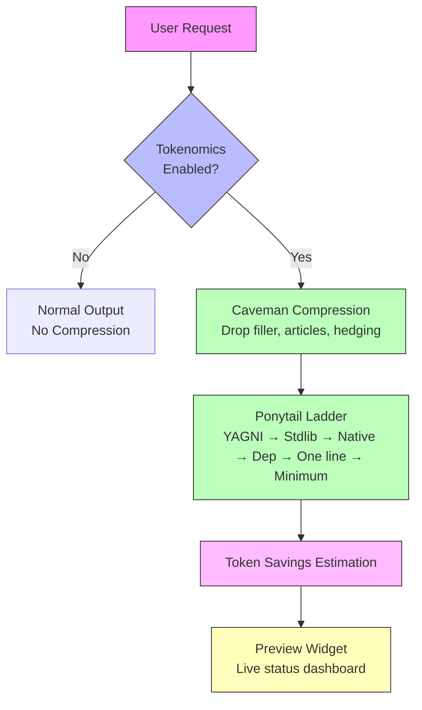
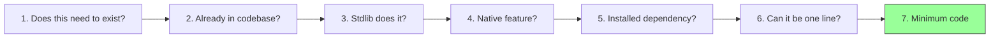

# Tokenomics for Cursor

**Small mouth, big brain. Minimum code, maximum impact.**

Tokenomics merges **caveman** (prose compression) + **ponytail** (code minimization) into one Cursor skill with token-savings estimation.

## Mermaid Architecture



## Triggers

Say any of these in Cursor:
- `tokenomics enable` / `tokenomics disable`
- `caveman mode` / `ponytail mode`
- `less tokens` / `minimal code`

## Ponytail Ladder



## Installation

Copy this `SKILL.md` to `~/.cursor/skills/tokenomics/`.

Or install via pip:
```bash
pip install tokenomics
```

## License

MIT License.
