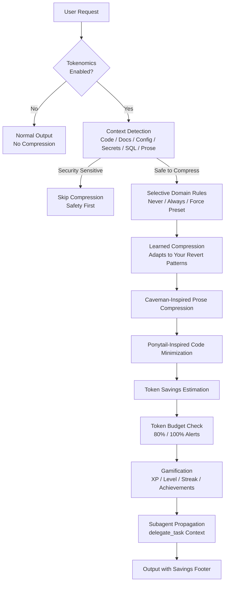

# Tokenomics for Cursor

**Small mouth, big brain. Minimum code, maximum impact.**

Tokenomics is inspired by the concepts behind caveman (prose compression)
and ponytail (code minimization), engineered independently as its own Cursor
skill.

## What It Does

| Layer | What it compresses | Typical savings |
|-------|-------------------|-----------------|
| Caveman-inspired | Agent's **prose output** — drops articles, filler, pleasantries, hedging | ~65% fewer output tokens |
| Ponytail-inspired | Agent's **code output** — YAGNI decision ladder before any code | ~54% less code |

## Mermaid Architecture



## Triggers

Say any of these in Cursor:

| Trigger | Effect |
|---------|--------|
| `tokenomics enable` | Activate compression + savings display |
| `tokenomics disable` | Deactivate — no compression, no footer |
| `tokenomics status` | View cumulative savings, level, streak |
| `tokenomics estimate <text>` | Preview savings for specific text |
| `tokenomics review <code>` | Ponytail-inspired over-engineering review |
| `tokenomics audit` | Full savings summary + recommendations |
| `tokenomics budget set <N>` | Set daily token budget |
| `tokenomics project web\|cli\|library\|api` | Set project type for smart defaults |
| `tokenomics learn true\|false` | Toggle auto-learn from user reverts |

## Installation

Copy this `SKILL.md` to `~/.cursor/skills/tokenomics/`.

Or install via pip:

```bash
pip install tokenomics
tokenomics enable
```

## License

MIT License.

## Inspiration

Tokenomics is **inspired by** caveman (prose compression) and ponytail (code minimization), but engineered independently as its own project.

- GitHub: https://github.com/z99wE/tokenomics
- caveman: https://github.com/JuliusBrussee/caveman
- ponytail: https://github.com/DietrichGebert/ponytail
